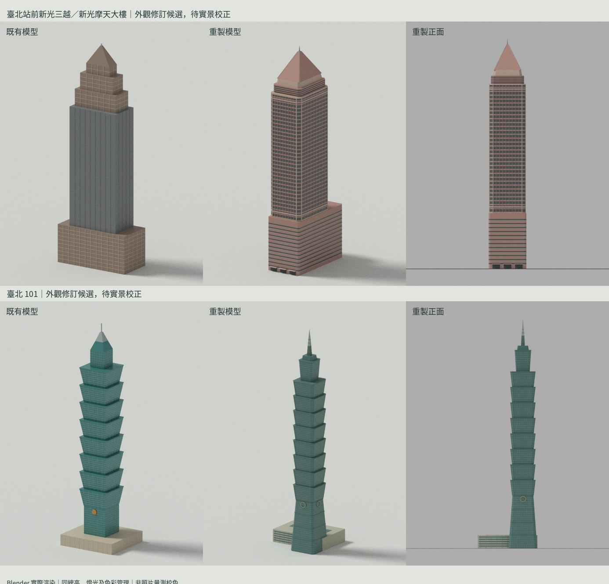

# 車站與地標製作批次

此批次包含完整 423 筆車站代碼工作名冊、既有 27 個場景對照，另加臺北 101 與臺北站前新光三越／新光摩天大樓重製。423 是代碼數，不是已完成模型數，也不是獨立建築數。

目前實作：
- 兩棟地標各有獨立 Blender 建模程式、分件原檔、近／遠 GLB、地圖原生 mesh.bin、實際渲染與新舊比較。
- 101 重建八節外擴塔身、收分基座、較窄塔冠、尖塔及商場分件。
- 新光重建百貨基座、辦公窗帶、退縮上部及金字塔屋頂；總高採管理公司資料。
- 13 組既有車站網格恢復成按材質／部件分組的可編輯 Blender 檔及 GLB。這是網格恢復，外觀未變；不能當成 13 站已重製，也沒有還原遺失的原始修改器。
- 臺北車站修訂 02 仍在 ../taipei-preview；立面退縮與採光罩細節尚未完成校正。

## 外觀完成度

兩棟地標仍是重製候選，尚未完成實拍逐面比對、立面朝向與地圖放樣驗證。官方總高已找到來源；各段高度、寬深、基座偏移、窗格及顏色為明列在 landmarks.json 的建模估值。不能把格式驗證或有照片連結當作外觀已符合實景。

照片來源仍保留於 station-manifest.json 的逐站 referenceRows/referenceUrls/photos 及原始參考分頁，沒有下載、重新發布照片或將照片用作材質。參考紀錄基準日 2026-10-09；平鎮、三鶯及臺南施工／營運版本須依紀錄分開。

地圖正式資產尚未被替換。rotationDeg、facadeBearingDeg 維持 null；繼承的 landmark anchor 也未通過放樣覆核。站點座標不是建築中心。

## 重建與檢查

在 repo 根目錄執行（Blender 4.0 以上，Python Pillow／NumPy、Noto CJK 字型）：

```sh
blender -b -t 2 --python-exit-code 1 --python prototypes/tiny-trains/blender/building-batch/build_landmarks.py -- output/building-batch
blender -b -t 2 --python-exit-code 1 --python prototypes/tiny-trains/blender/building-batch/verify.py -- output/building-batch
blender -b -t 2 --python-exit-code 1 --python prototypes/tiny-trains/blender/building-batch/recover_stations.py -- output/building-batch
python3 prototypes/tiny-trains/blender/building-batch/compose.py
```

格式檢查包括 Blender 原檔可開啟、可編輯部件、GLB 往返尺度、有效座標／法線、材質群組範圍、雜湊、官方總高與近／遠景面數。沒有以此宣稱手機幀率或現實精度驗收。

完成條件：外觀照片比對、可編輯原檔、近／遠景模型、正確地理放樣及手機地圖檢查。每站獨立判定，不以批次匯出成功全數打勾。

## 本次實際產出（2026-10-12）

[下載完整模型包](https://github.com/siriushsu/taiwan-rail-live/actions/runs/38288479241/artifacts/11764298352)（約 22.7 MB，Actions 保留至 2027-01-10）。解壓後開啟 `review.html` 可看兩棟地標及搜尋 423 列車站照片來源。建模程式留在此目錄，可重新產生檔案。



| 候選模型 | Blender 分件 | 近景三角形 | 遠景三角形 | 地圖材質繪製群組（近／遠） |
| --- | ---: | ---: | ---: | ---: |
| 臺北 101 | 656 | 8,920 | 1,800 | 5／4 |
| 新光摩天大樓 | 125 | 2,732 | 1,596 | 5／5 |

兩棟均通過 Blender 開啟、GLB 往返尺度及原生網格檢查；往返包圍盒誤差為 0。101 節間共面黑邊已在實際渲染檢查後修正。這是模型自身的檢查，不是實拍外觀驗收；全量車站重製仍未完成。參考工具目前只提供網頁文字與圖片占位符，無法完成實景逐面目視核對。

原始建模輸出 commit：`87d64a170f25e0b6b133102e92ea9363ed966370`。詳見 `validation.json`、`delivery.json`。

## 接續車站製作（2026-10-13）

六組站體候選與工作檔已另存批次。下載、預覽與剩餘工作見[製作進度](../PRODUCTION-STATUS.md)。全量清單仍未全部完成。
