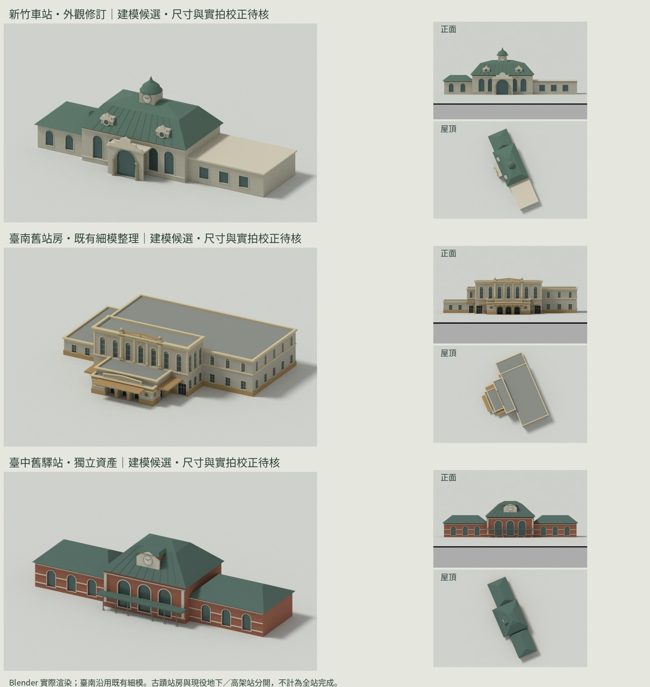

# 特色車站第二批：新竹、臺南舊站房、臺中舊驛站

新竹與臺中舊驛站是依官方建築特徵製作的外觀候選，尺寸、屋頂／鐘塔細節與色票尚待照片逐面校正。臺中舊驛站不取代現役高架站；TRA:3300 的現役站仍待重修。

臺南沿用專案 tainan-memory-v1 的詳細幾何，保留原有三拱門廊、七扇長窗、山形壁、雨庇托架、側後翼與修復色票，按構件／材質整理為 Blender 可編輯物件。它是既有模型的轉製與 LOD 整理，不是本次重新校正完成。原有 source metadata 與 pendingChecks 隨包保存；歷史封存目錄不改寫。施工外罩及地下新站另列。

每組包含 .blend、近／遠 GLB、24-byte stride 的地圖 mesh.bin、來源與模型資料、三視角實際渲染。GLB Y-up；原生及 mesh.bin Z-up。照片僅保留來源網址，未複製作貼圖。OSM 衍生平面資料依原來源保留 © OpenStreetMap contributors / ODbL 標示。

重建（repo 根目錄）：

```sh
blender -b -t 2 --python-exit-code 1 --python prototypes/tiny-trains/blender/station-heritage/build.py -- output/station-heritage
blender -b -t 2 --python-exit-code 1 --python prototypes/tiny-trains/blender/station-heritage/verify.py -- output/station-heritage
python3 prototypes/tiny-trains/blender/station-heritage/compose.py
```

依賴 building-batch/core.py 與 tainan-memory-v1 的幾何工具。臺南近景保留原始三角形與法線；遠景僅合併重複頂點和共平面三角形，不做位移或任意比例壓縮。兩個 LOD 分開保存，遠景物件在 Blender 預設隱藏。

全部 anchor／rotation 仍待放樣，productionReady=false。成功匯出不是實拍驗收，也不是手機幀率驗收。

臺南沿用的遠景細節多，單獨列 8,000 三角形預算（原來源 7,638）；新竹與臺中舊驛站仍各 6,000。通用匯出器的預設維持 6,000。這個差異不代表手機效能已通過，後續需按真實地圖負載驗證。

## 已產出的模型包

[下載 Blender／地圖模型包](https://github.com/siriushsu/taiwan-rail-live/actions/runs/38294205615/artifacts/11767494868)（約 18.4 MB，2027-01-10 到期）。[驗證](validation.json) · [實際預覽](contact-sheet.jpg)。



| 資產 | Blender 物件（含近／遠組） | 近景三角形 | 遠景三角形 | 材質群組（近／遠） |
| --- | ---: | ---: | ---: | ---: |
| 新竹車站・外觀修訂 | 92 | 3,230 | 2,102 | 8／7 |
| 臺南舊站房・既有細模整理 | 64 | 35,598 | 7,632 | 8／7 |
| 臺中舊驛站・獨立資產 | 87 | 2,657 | 1,659 | 8／8 |

三組 GLB 兩級往返包圍盒誤差均為 0。新竹牛眼窗、臺中窗洞及臺南七扇長窗可見性均已檢查。臺南保留原始近景及16項待核記錄，未改寫歷史重播封存。這些檢查不代表完成實拍校正與手機效能驗收。

來源提交：359aa207481ee7c8d3a859b1454b4882b8827159。
